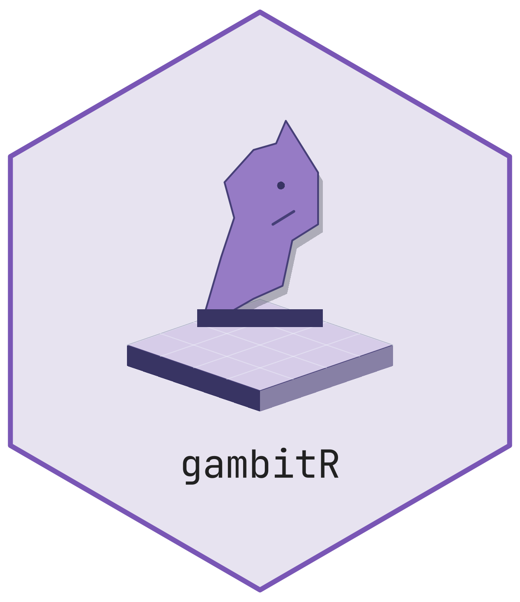

# gambitR <picture class="cttir-readme-logo"><source class="cttir-logo-dark-source" media="(prefers-color-scheme: dark)" srcset="man/figures/logo-dark.png" /></picture>
<!-- badges: start -->
[](https://github.com/r-heller/gambitR/actions/workflows/R-CMD-check.yaml)
[](https://app.codecov.io/gh/r-heller/gambitR?branch=main)
[](https://opensource.org/licenses/MIT)
[](https://lifecycle.r-lib.org/articles/stages.html#experimental)
<!-- badges: end -->

A self-contained chess toolkit in native R: legal move generation, FEN/PGN I/O,
position evaluation and alpha-beta search, batch simulation, an opening
explorer, a puzzle trainer, and an interactive Shiny study app. An optional UCI
hook (e.g. Stockfish) enables deeper analysis.

## Why gambitR?

`gambitR` combines native R move generation with play, simulation, an opening
explorer, a puzzle trainer, and an interactive study app. Move generation does
not require an external chess engine; UCI analysis is optional.

## Installation

```r
# install.packages("remotes")
remotes::install_github("r-heller/gambitR")
```

## Quick start

```r
library(gambitR)

pos <- gm_position()
gm_legal_moves(pos)
gm_plot_board(pos)

# Read a game and replay it
game <- gm_read_pgn("1. e4 e5 2. Nf3 Nc6 3. Bb5 a6 *", text = TRUE)
gm_identify_opening(game)

# Evaluate and search
gm_evaluate(pos)
gm_bestmove(pos, depth = 2)

# Play the native engine against a random mover, then batch it
gm_play(white = "engine", black = "random")
gm_simulate(white = "random", black = "random", n = 20)

# Train on the bundled puzzles
puzzle <- gm_puzzle(seed = 1)
gm_check_solution(puzzle, puzzle$solution)

# Launch the interactive app
gm_run_app()
```

## Correctness

Move generation is verified against the published
[perft](https://www.chessprogramming.org/Perft) reference counts, with
regression checks for castling rights, en passant, pinned pieces and promotion.
These reference positions do not constitute an exhaustive proof:

| Position | Depth 1 | Depth 2 | Depth 3 | Depth 4 |
|---|--:|--:|--:|--:|
| Start position | 20 | 400 | 8,902 | 197,281 |
| Kiwipete | 48 | 2,039 | 97,862 | |
| Position 3 | 14 | 191 | 2,812 | 43,238 |
| Position 4 | 6 | 264 | 9,467 | 422,333 |
| Position 5 | 44 | 1,486 | 62,379 | |

These run as part of the test suite; depths 1 and 2 run everywhere, deeper
counts are skipped on CRAN for time.

## Local maintenance candidate

See [MAINTENANCE.md](https://github.com/r-heller/gambitR/blob/main/MAINTENANCE.md) for the 30 October 2026 repairs, exact local
installation path, verification results and remaining release limits.
