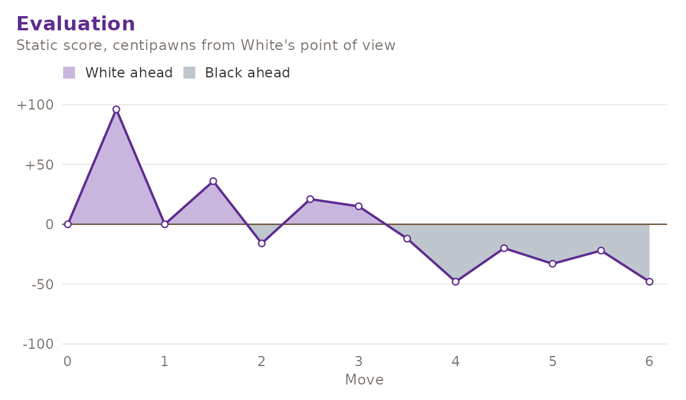

# Evaluation, Search and the UCI Hook

``` r

library(gambitR)
```

This article covers the analysis half of gambitR: the static evaluation,
the native alpha-beta search on top of it, and the optional hook to an
external UCI engine.

## The static evaluation

[`gm_evaluate()`](https://r-heller.github.io/gambitR/reference/gm_evaluate.md)
returns a score in centipawns, always from White’s point of view. It is
the weighted sum of three terms:

- **material**, using the conventional values (pawn 100, knight 320,
  bishop 330, rook 500, queen 900) together with piece-square bonuses,
- **mobility**, the difference in the number of legal moves each side
  has,
- **king safety**, the difference in pawn shelter in front of each king.

``` r

gm_evaluate(gm_position())
#> [1] 0
```

The starting position scores zero because the evaluation is
colour-symmetric by construction: the piece-square tables are mirrored
for Black, and both mobility and shelter are differences of two
quantities computed the same way for each side. Mirroring a position
therefore negates its score.

``` r

kiwipete <- gm_position(
  "r3k2r/p1ppqpb1/bn2pnp1/3PN3/1p2P3/2N2Q1p/PPPBBPPP/R3K2R w KQkq - 0 1"
)
gm_evaluate(kiwipete)
#> [1] 78
```

The weights can be changed. Setting `mobility` and `king_safety` to zero
leaves the pure material-plus-placement score.

``` r

gm_evaluate(kiwipete, weights = list(mobility = 0, king_safety = 0))
#> [1] 70
```

Development is rewarded, which is what stops the search from shuffling
in the opening:

``` r

gm_evaluate(gm_position("rnbqkbnr/pppppppp/8/8/8/5N2/PPPPPPPP/RNBQKB1R b KQkq - 1 1"))
#> [1] 52
```

## The native search

[`gm_bestmove()`](https://r-heller.github.io/gambitR/reference/gm_bestmove.md)
is a negamax search with alpha-beta pruning. Captures are tried first,
most valuable victim before least valuable attacker, which is what makes
the pruning effective.

``` r

gm_bestmove(gm_position(), depth = 2, verbose = FALSE)
#> # A tibble: 1 × 4
#>   san   score depth nodes
#>   <chr> <dbl> <int> <int>
#> 1 e4        0     2   223
```

Mates are scored near `100000` and discounted by the distance to mate,
so a mate in one is always preferred to a longer one.

``` r

gm_bestmove(
  gm_position("r1bqkbnr/pppp1ppp/2n5/4p3/2B1P3/5Q2/PPPP1PPP/RNB1K1NR w KQkq - 4 4"),
  depth = 2, verbose = FALSE
)
#> # A tibble: 1 × 4
#>   san   score depth nodes
#>   <chr> <dbl> <int> <int>
#> 1 Qxf7# 99999     2    83
```

It also sees mates coming the other way. Here Black is to move and mates
at once:

``` r

gm_bestmove(
  gm_position("rnbqkbnr/pppp1ppp/8/4p3/6P1/5P2/PPPPP2P/RNBQKBNR b KQkq g3 0 2"),
  depth = 2, verbose = FALSE
)
#> # A tibble: 1 × 4
#>   san    score depth nodes
#>   <chr>  <dbl> <int> <int>
#> 1 Qh4#  -99999     2   124
```

The `nodes` column reports how many nodes the search visited, which is
the honest way to compare depths.

``` r

rbind(
  gm_bestmove(gm_position(), depth = 1, verbose = FALSE),
  gm_bestmove(gm_position(), depth = 2, verbose = FALSE)
)
#> # A tibble: 2 × 4
#>   san   score depth nodes
#>   <chr> <dbl> <int> <int>
#> 1 e4       96     1    20
#> 2 e4        0     2   223
```

Because the search is pure R, depth grows expensive quickly. Depths 1 to
3 are comfortable for interactive use; beyond that, reach for an
external engine.

## Reviewing a whole game

[`gm_plot_eval()`](https://r-heller.github.io/gambitR/reference/gm_plot_eval.md)
scores every position of a game and draws the curve.

``` r

game <- gm_read_pgn(
  "1. e4 e5 2. Nf3 Nc6 3. Bb5 a6 4. Ba4 Nf6 5. O-O Be7 6. Re1 b5 *",
  text = TRUE
)
gm_plot_eval(game)
```



With `depth` greater than one the curve is recomputed with the search
rather than the static evaluation, which is slower but accounts for
tactics.

## The UCI hook

[`gm_uci_bestmove()`](https://r-heller.github.io/gambitR/reference/gm_uci_bestmove.md)
drives an external engine over the Universal Chess Interface. It needs
the optional package and an engine binary; by default it looks for
`stockfish` on the `PATH`.

``` r

# Is an engine available on this machine?
requireNamespace("processx", quietly = TRUE) && nzchar(Sys.which("stockfish"))
#> [1] FALSE
```

``` r

gm_uci_bestmove(gm_position(), movetime = 1000)
#> # A tibble: 1 x 3
#>   san   score pv
#>   <chr> <dbl> <chr>
#> 1 e4       25 e2e4 e7e5 g1f3
```

The client completes the full handshake (`uci` until `uciok`, `isready`
until `readyok`, then `position fen ...` and `go movetime ...` until
`bestmove`), parses the last `info` line for the score, depth and node
count, and converts the engine’s long algebraic reply back into standard
algebraic notation. The engine process is shut down even if the call
errors.

Scores are normalised to White’s point of view, matching
[`gm_evaluate()`](https://r-heller.github.io/gambitR/reference/gm_evaluate.md),
and a forced mate is reported as `100000` minus the distance. The same
engine can be reached through `gm_bestmove(engine = "uci")`, which
additionally reports the depth and node count the engine itself
announced.

If neither the package nor a binary is present, both functions fail with
an explanatory error rather than silently falling back, so an analysis
script cannot quietly change engine underneath you.
