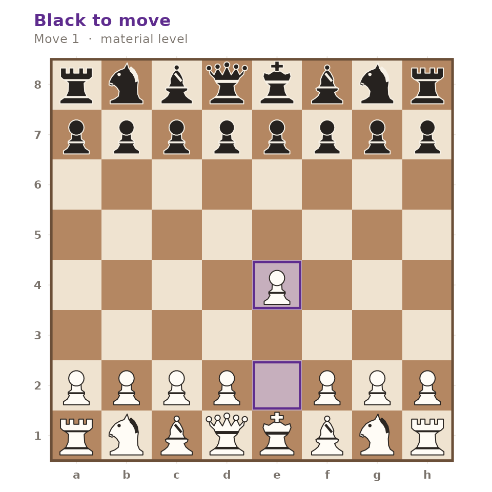
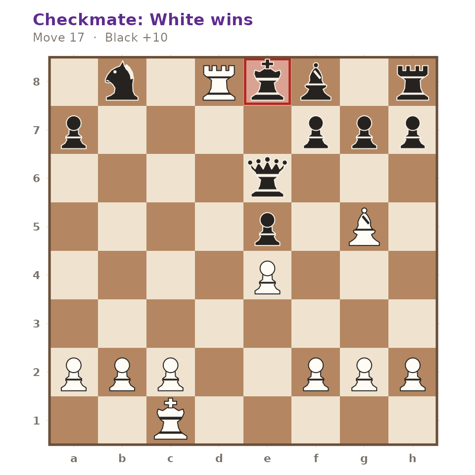

# Getting Started with gambitR

``` r

library(gambitR)
```

gambitR is a self-contained chess toolkit written in plain R. Nothing
outside R is required: move generation, notation, evaluation and search
are all implemented in the package. This article walks the whole
pipeline once, from a position to a finished game.

## A position

Every workflow starts from a `gm_position`. The default is the standard
starting position.

``` r

pos <- gm_position()
pos
#> <gm_position> — White to move
#> 8  ♜ ♞ ♝ ♛ ♚ ♝ ♞ ♜
#> 7  ♟ ♟ ♟ ♟ ♟ ♟ ♟ ♟
#> 6  · · · · · · · ·
#> 5  · · · · · · · ·
#> 4  · · · · · · · ·
#> 3  · · · · · · · ·
#> 2  ♙ ♙ ♙ ♙ ♙ ♙ ♙ ♙
#> 1  ♖ ♘ ♗ ♕ ♔ ♗ ♘ ♖
#>    a b c d e f g h
#> FEN: "rnbqkbnr/pppppppp/8/8/8/8/PPPPPPPP/RNBQKBNR w KQkq - 0 1"
```

Positions are read from and written to Forsyth-Edwards Notation, and the
two are exact inverses of one another.

``` r

fen <- gm_write_fen(pos)
fen
#> [1] "rnbqkbnr/pppppppp/8/8/8/8/PPPPPPPP/RNBQKBNR w KQkq - 0 1"
identical(gm_write_fen(gm_read_fen(fen)), fen)
#> [1] TRUE
```

Any legal position can be supplied directly.

``` r

gm_position("r1bqkbnr/pppp1ppp/2n5/4p3/2B1P3/5Q2/PPPP1PPP/RNB1K1NR w KQkq - 4 4")
#> <gm_position> — White to move
#> 8  ♜ · ♝ ♛ ♚ ♝ ♞ ♜
#> 7  ♟ ♟ ♟ ♟ · ♟ ♟ ♟
#> 6  · · ♞ · · · · ·
#> 5  · · · · ♟ · · ·
#> 4  · · ♗ · ♙ · · ·
#> 3  · · · · · ♕ · ·
#> 2  ♙ ♙ ♙ ♙ · ♙ ♙ ♙
#> 1  ♖ ♘ ♗ · ♔ · ♘ ♖
#>    a b c d e f g h
#> FEN: "r1bqkbnr/pppp1ppp/2n5/4p3/2B1P3/5Q2/PPPP1PPP/RNB1K1NR w KQkq - 4 4"
```

## Legal moves

[`gm_legal_moves()`](https://r-heller.github.io/gambitR/reference/gm_legal_moves.md)
enumerates every legal move, with standard algebraic notation already
resolved, including disambiguation and check or mate suffixes.

``` r

moves <- gm_legal_moves(pos)
moves
#> # A tibble: 20 × 6
#>    from  to    piece san   promotion flag  
#>    <chr> <chr> <chr> <chr> <chr>     <chr> 
#>  1 a2    a3    P     a3    NA        normal
#>  2 a2    a4    P     a4    NA        normal
#>  3 b2    b3    P     b3    NA        normal
#>  4 b2    b4    P     b4    NA        normal
#>  5 c2    c3    P     c3    NA        normal
#>  6 c2    c4    P     c4    NA        normal
#>  7 d2    d3    P     d3    NA        normal
#>  8 d2    d4    P     d4    NA        normal
#>  9 e2    e3    P     e3    NA        normal
#> 10 e2    e4    P     e4    NA        normal
#> 11 f2    f3    P     f3    NA        normal
#> 12 f2    f4    P     f4    NA        normal
#> 13 g2    g3    P     g3    NA        normal
#> 14 g2    g4    P     g4    NA        normal
#> 15 h2    h3    P     h3    NA        normal
#> 16 h2    h4    P     h4    NA        normal
#> 17 b1    a3    N     Na3   NA        normal
#> 18 b1    c3    N     Nc3   NA        normal
#> 19 g1    f3    N     Nf3   NA        normal
#> 20 g1    h3    N     Nh3   NA        normal
```

The generator is verified against the published perft reference counts,
so castling, en passant, promotion and pins are all handled exactly.
Here is a position where exactly one en passant capture is legal:

``` r

ep <- gm_position("rnbqkbnr/ppp1p1pp/8/3pPp2/8/8/PPPP1PPP/RNBQKBNR w KQkq f6 0 3")
subset(gm_legal_moves(ep), flag == "ep")
#> # A tibble: 1 × 6
#>   from  to    piece san   promotion flag 
#>   <chr> <chr> <chr> <chr> <chr>     <chr>
#> 1 e5    f6    P     exf6  NA        ep
```

Moves are applied with
[`gm_move()`](https://r-heller.github.io/gambitR/reference/gm_move.md),
which accepts standard algebraic notation or the long algebraic form an
engine would use.

``` r

gm_write_fen(gm_move(pos, "e4"))
#> [1] "rnbqkbnr/pppppppp/8/8/4P3/8/PPPP1PPP/RNBQKBNR b KQkq e3 0 1"
gm_write_fen(gm_move(pos, "e2e4"))
#> [1] "rnbqkbnr/pppppppp/8/8/4P3/8/PPPP1PPP/RNBQKBNR b KQkq e3 0 1"
```

[`gm_status()`](https://r-heller.github.io/gambitR/reference/gm_status.md)
reports the state of the game.

``` r

fools_mate <- gm_position("rnb1kbnr/pppp1ppp/8/4p3/6Pq/5P2/PPPPP2P/RNBQKBNR w KQkq - 1 3")
gm_status(fools_mate)
#> [1] "checkmate"
nrow(gm_legal_moves(fools_mate))
#> [1] 0
```

## Drawing a board

[`gm_plot_board()`](https://r-heller.github.io/gambitR/reference/gm_plot_board.md)
returns a `ggplot2` object, so it composes with the rest of the grammar
of graphics rather than drawing to a device itself.

``` r

gm_plot_board(gm_move(pos, "e4"), highlight = c("e2", "e4"))
```



`autoplot()` dispatches to the same function, and `flip = TRUE` shows
the board from Black’s side.

## Reading and writing PGN

[`gm_read_pgn()`](https://r-heller.github.io/gambitR/reference/gm_read_pgn.md)
parses header tags and movetext, strips comments, numeric annotation
glyphs and variations, and replays the mainline through the generator.
Here is Morphy’s Opera Game.

``` r

opera <- paste(
  '[Event "Paris Opera"]',
  '[White "Morphy, Paul"]',
  '[Black "Duke Karl / Count Isouard"]',
  '[Result "1-0"]',
  "",
  "1. e4 e5 2. Nf3 d6 3. d4 Bg4 {A dubious pin.} 4. dxe5 Bxf3 5. Qxf3 dxe5",
  "6. Bc4 Nf6 7. Qb3 Qe7 8. Nc3 c6 9. Bg5 b5 10. Nxb5 cxb5 11. Bxb5+ Nbd7",
  "12. O-O-O Rd8 13. Rxd7 Rxd7 14. Rd1 Qe6 15. Bxd7+ Nxd7 16. Qb8+ Nxb8",
  "17. Rd8# 1-0",
  sep = "\n"
)

game <- gm_read_pgn(opera, text = TRUE)
game
#> <gm_game> — 33 half-moves, result "1-0"
#> Morphy, Paul vs Duke Karl / Count Isouard
#> 1. e4 e5 2. Nf3 d6 3. d4 Bg4 4. dxe5 Bxf3 5. Qxf3 dxe5 6. Bc4 Nf6 ...
```

Because every move was replayed, the final position really is mate.

``` r

final <- game$positions[[length(game$positions)]]
gm_status(final)
#> [1] "checkmate"
```

``` r

gm_plot_board(final)
```



[`gm_write_pgn()`](https://r-heller.github.io/gambitR/reference/gm_write_pgn.md)
is the inverse, and round-trips the mainline.

``` r

identical(gm_read_pgn(gm_write_pgn(game), text = TRUE)$moves, game$moves)
#> [1] TRUE
```

## Evaluation and search

[`gm_evaluate()`](https://r-heller.github.io/gambitR/reference/gm_evaluate.md)
scores a position in centipawns from White’s point of view, combining
material, piece-square tables, mobility and pawn shelter. The starting
position is symmetric, so it scores zero.

``` r

gm_evaluate(gm_position())
#> [1] 0
gm_evaluate(gm_position("rnb1kbnr/pppppppp/8/8/8/8/PPPPPPPP/RNBQKBNR w KQkq - 0 1"))
#> [1] 876
```

[`gm_bestmove()`](https://r-heller.github.io/gambitR/reference/gm_bestmove.md)
runs an alpha-beta search on top of that evaluation. It finds forced
mates.

``` r

gm_bestmove(gm_position("6k1/5ppp/8/8/8/8/5PPP/R5K1 w - - 0 1"),
  depth = 2, verbose = FALSE
)
#> # A tibble: 1 × 4
#>   san   score depth nodes
#>   <chr> <dbl> <int> <int>
#> 1 Ra8#  99999     2    78
```

If an external UCI engine such as Stockfish is on the `PATH`,
`engine = "uci"` delegates to it through
[`gm_uci_bestmove()`](https://r-heller.github.io/gambitR/reference/gm_uci_bestmove.md)
instead. See the analysis article for details.

## Playing and simulating

[`gm_play()`](https://r-heller.github.io/gambitR/reference/gm_play.md)
runs a whole game between two strategies, which may be the built-in
shortcuts `"random"` and `"engine"` or any function that takes a
position and returns a move.

``` r

set.seed(2)
played <- gm_play(white = "random", black = "random", max_moves = 30, verbose = FALSE)
played
#> <gm_game> — 60 half-moves, result "1/2-1/2"
#> random vs random
#> 1. h3 a5 2. c3 b5 3. Qb3 g6 4. h4 Nf6 5. e4 c5 6. e5 Na6 ...
played$tags$Termination
#> [1] "move limit"
```

[`gm_simulate()`](https://r-heller.github.io/gambitR/reference/gm_simulate.md)
batches that into a tidy summary.

``` r

set.seed(3)
gm_simulate(white = "random", black = "random", n = 3, max_moves = 20, verbose = FALSE)
#> # A tibble: 3 × 4
#>    game result  plies termination
#>   <int> <chr>   <int> <chr>      
#> 1     1 1/2-1/2    40 move limit 
#> 2     2 1/2-1/2    40 move limit 
#> 3     3 1/2-1/2    40 move limit
```

## Openings and puzzles

The bundled ECO book and puzzle set drive the explorer and the trainer.

``` r

head(gm_openings("Sicilian Defense")[, c("eco", "name")])
#> # A tibble: 6 × 2
#>   eco   name                                      
#>   <chr> <chr>                                     
#> 1 B20   Sicilian Defense                          
#> 2 B21   Sicilian Defense, Smith-Morra Gambit      
#> 3 B22   Sicilian Defense, Alapin Variation        
#> 4 B23   Sicilian Defense, Closed Variation        
#> 5 B27   Sicilian Defense, Hyperaccelerated Dragon 
#> 6 B29   Sicilian Defense, Nimzo-American Variation
gm_identify_opening(game)
#> # A tibble: 1 × 3
#>   eco   name             book_depth
#>   <chr> <chr>                 <int>
#> 1 C41   Philidor Defense          4
```

``` r

puzzle <- gm_puzzle(id = "gm-0001")
puzzle
#> <gm_puzzle> "gm-0001" — theme "backRank", rating 800
#> White to move, 1 move to find
#> 8  · · · · · · ♚ ·
#> 7  · · · · · ♟ ♟ ♟
#> 6  · · · · · · · ·
#> 5  · · · · · · · ·
#> 4  · · · · · · · ·
#> 3  · · · · · · · ·
#> 2  · · · · · ♙ ♙ ♙
#> 1  ♖ · · · · · ♔ ·
#>    a b c d e f g h
gm_check_solution(puzzle, puzzle$solution)
#> # A tibble: 1 × 3
#>   correct solved_plies total_plies
#>   <lgl>          <int>       <int>
#> 1 TRUE               1           1
```

## Where to go next

- [`vignette("analysis", package = "gambitR")`](https://r-heller.github.io/gambitR/articles/analysis.md)
  for evaluation, search and the UCI hook.
- [`vignette("openings", package = "gambitR")`](https://r-heller.github.io/gambitR/articles/openings.md)
  for the opening explorer.
- [`vignette("puzzles", package = "gambitR")`](https://r-heller.github.io/gambitR/articles/puzzles.md)
  for the puzzle trainer.
- [`gm_run_app()`](https://r-heller.github.io/gambitR/reference/gm_run_app.md)
  launches the interactive study application, which puts all six of
  these workflows behind one interface.
