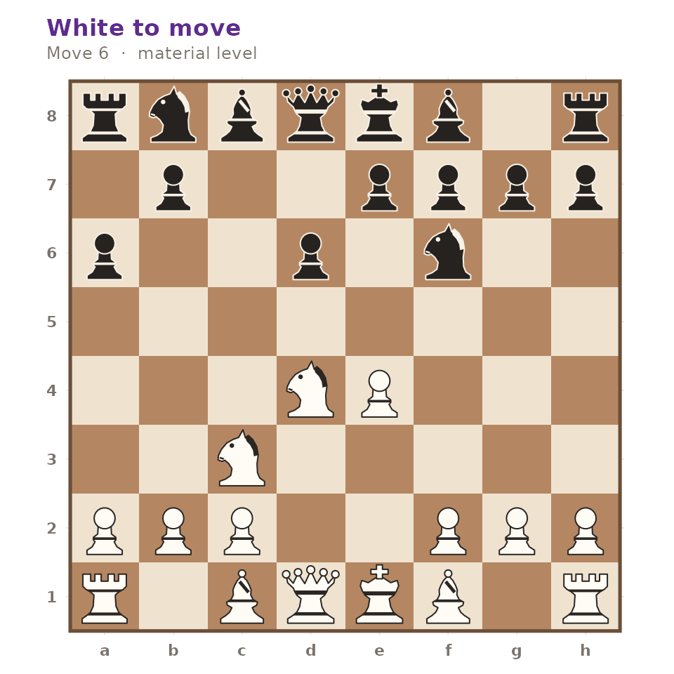

# The Opening Explorer

``` r

library(gambitR)
```

gambitR ships a compact ECO opening book. Every line in it was replayed
through the package’s own move generator when the book was built, so no
unplayable sequence can reach it, and the resulting position is stored
alongside the moves.

## The book

[`gm_openings()`](https://r-heller.github.io/gambitR/reference/gm_openings.md)
with no arguments returns the whole book.

``` r

book <- gm_openings()
nrow(book)
#> [1] 180
head(book[, c("eco", "name", "moves")])
#> # A tibble: 6 × 3
#>   eco   name                moves
#>   <chr> <chr>               <chr>
#> 1 A00   Amar Opening        Nh3  
#> 2 A00   Anderssen's Opening a3   
#> 3 A00   Barnes Opening      f3   
#> 4 A00   Clemenz Opening     h3   
#> 5 A00   Grob Opening        g4   
#> 6 A00   Hungarian Opening   g3
```

Each row carries the ECO code, the opening name, the moves in standard
algebraic notation and the FEN of the resulting position.

``` r

range(book$eco)
#> [1] "A00" "E97"
table(substr(book$eco, 1, 1))
#> 
#>  A  B  C  D  E 
#> 57 38 39 27 19
```

## Searching by name

`query` is a case-insensitive regular expression matched against the
opening name.

``` r

gm_openings("Ruy Lopez")[, c("eco", "name")]
#> # A tibble: 10 × 2
#>    eco   name                                          
#>    <chr> <chr>                                         
#>  1 C60   Ruy Lopez                                     
#>  2 C62   Ruy Lopez, Old Steinitz Defense               
#>  3 C64   Ruy Lopez, Classical Variation                
#>  4 C65   Ruy Lopez, Berlin Defense                     
#>  5 C68   Ruy Lopez, Exchange Variation                 
#>  6 C70   Ruy Lopez, Morphy Defense                     
#>  7 C77   Ruy Lopez, Morphy Defense, Anderssen Variation
#>  8 C84   Ruy Lopez, Closed Variation                   
#>  9 C88   Ruy Lopez, Closed, Anti-Marshall              
#> 10 C89   Ruy Lopez, Marshall Attack
```

Because it is a regular expression, alternation works too.

``` r

gm_openings("Gambit")[, c("eco", "name")]
#> # A tibble: 21 × 2
#>    eco   name                                        
#>    <chr> <chr>                                       
#>  1 A40   Englund Gambit                              
#>  2 A51   Budapest Gambit                             
#>  3 A57   Benko Gambit                                
#>  4 A82   Dutch Defense, Staunton Gambit              
#>  5 B21   Sicilian Defense, Smith-Morra Gambit        
#>  6 C30   King's Gambit                               
#>  7 C33   King's Gambit Accepted                      
#>  8 C34   King's Gambit Accepted, King's Knight Gambit
#>  9 C51   Evans Gambit                                
#> 10 D06   Queen's Gambit                              
#> # ℹ 11 more rows
```

## Searching by code

`eco` is matched as a prefix, so a partial code selects a whole range.

``` r

gm_openings(eco = "C5")[, c("eco", "name")]
#> # A tibble: 6 × 2
#>   eco   name                                         
#>   <chr> <chr>                                        
#> 1 C50   Italian Game                                 
#> 2 C50   Italian Game, Giuoco Piano                   
#> 3 C51   Evans Gambit                                 
#> 4 C53   Italian Game, Classical Variation            
#> 5 C55   Italian Game, Two Knights Defense            
#> 6 C57   Italian Game, Two Knights, Fried Liver Attack
```

The two filters combine.

``` r

gm_openings("Defense", eco = "E")[, c("eco", "name")]
#> # A tibble: 17 × 2
#>    eco   name                                                  
#>    <chr> <chr>                                                 
#>  1 E00   Indian Game, East Indian Defense                      
#>  2 E04   Catalan Opening, Open Defense                         
#>  3 E11   Bogo-Indian Defense                                   
#>  4 E12   Queen's Indian Defense                                
#>  5 E15   Queen's Indian Defense, Fianchetto Variation          
#>  6 E20   Nimzo-Indian Defense                                  
#>  7 E21   Nimzo-Indian Defense, Three Knights Variation         
#>  8 E32   Nimzo-Indian Defense, Classical Variation             
#>  9 E40   Nimzo-Indian Defense, Rubinstein Variation            
#> 10 E60   King's Indian Defense                                 
#> 11 E61   King's Indian Defense, Normal Variation               
#> 12 E62   King's Indian Defense, Fianchetto Variation           
#> 13 E70   King's Indian Defense, Normal Variation, King's Knight
#> 14 E73   King's Indian Defense, Averbakh Variation             
#> 15 E80   King's Indian Defense, Samisch Variation              
#> 16 E90   King's Indian Defense, Classical Variation            
#> 17 E97   King's Indian Defense, Mar del Plata
```

Nothing ever returns `NULL`: a query that matches nothing gives a
zero-row tibble with the same columns.

``` r

gm_openings("Klingon Gambit")
#> # A tibble: 0 × 4
#> # ℹ 4 variables: eco <chr>, name <chr>, moves <chr>, fen <chr>
```

## Walking a line onto the board

The `moves` column replays directly.

``` r

line <- gm_openings("Sicilian Defense, Najdorf Variation")
line$name
#> [1] "Sicilian Defense, Najdorf Variation"

position <- gm_position()
for (san in strsplit(line$moves[[1]], " ")[[1]]) {
  position <- gm_move(position, san)
}
identical(gm_write_fen(position), line$fen[[1]])
#> [1] TRUE
```

``` r

gm_plot_board(position)
```



## Identifying the opening of a game

[`gm_identify_opening()`](https://r-heller.github.io/gambitR/reference/gm_identify_opening.md)
walks a game against the book and reports the deepest line the game
follows, together with the ply at which the book ran out.

``` r

game <- gm_read_pgn(
  "1. e4 c5 2. Nf3 d6 3. d4 cxd4 4. Nxd4 Nf6 5. Nc3 a6 6. Be3 e5 7. Nb3 Be6 *",
  text = TRUE
)
gm_identify_opening(game)
#> # A tibble: 1 × 3
#>   eco   name                                book_depth
#>   <chr> <chr>                                    <int>
#> 1 B90   Sicilian Defense, Najdorf Variation         10
```

Comparison ignores check, mate and annotation marks, so notation from
different sources still lines up.

``` r

gm_identify_opening(gm_read_pgn("1. e4 c5 2. Nf3 d6 3. Bb5+ Bd7 *", text = TRUE))
#> # A tibble: 1 × 3
#>   eco   name                               book_depth
#>   <chr> <chr>                                   <int>
#> 1 B51   Sicilian Defense, Moscow Variation          5
```

A game that leaves the book immediately returns zero rows rather than a
misleading match.

``` r

gm_identify_opening(gm_read_pgn("1. a3 h6 2. a4 h5 *", text = TRUE))
#> # A tibble: 1 × 3
#>   eco   name                book_depth
#>   <chr> <chr>                    <int>
#> 1 A00   Anderssen's Opening          1
```

## Where the data comes from

The book lives in `inst/extdata/eco.rds` and is generated by
`data-raw/eco.R`. The generator holds the ECO codes, names and move
sequences as literal text, replays each one, and fails loudly on any
line that cannot be played, so a typo becomes a build error rather than
a silently wrong row. The Openings tab of
[`gm_run_app()`](https://r-heller.github.io/gambitR/reference/gm_run_app.md)
is a front end to exactly these functions.
