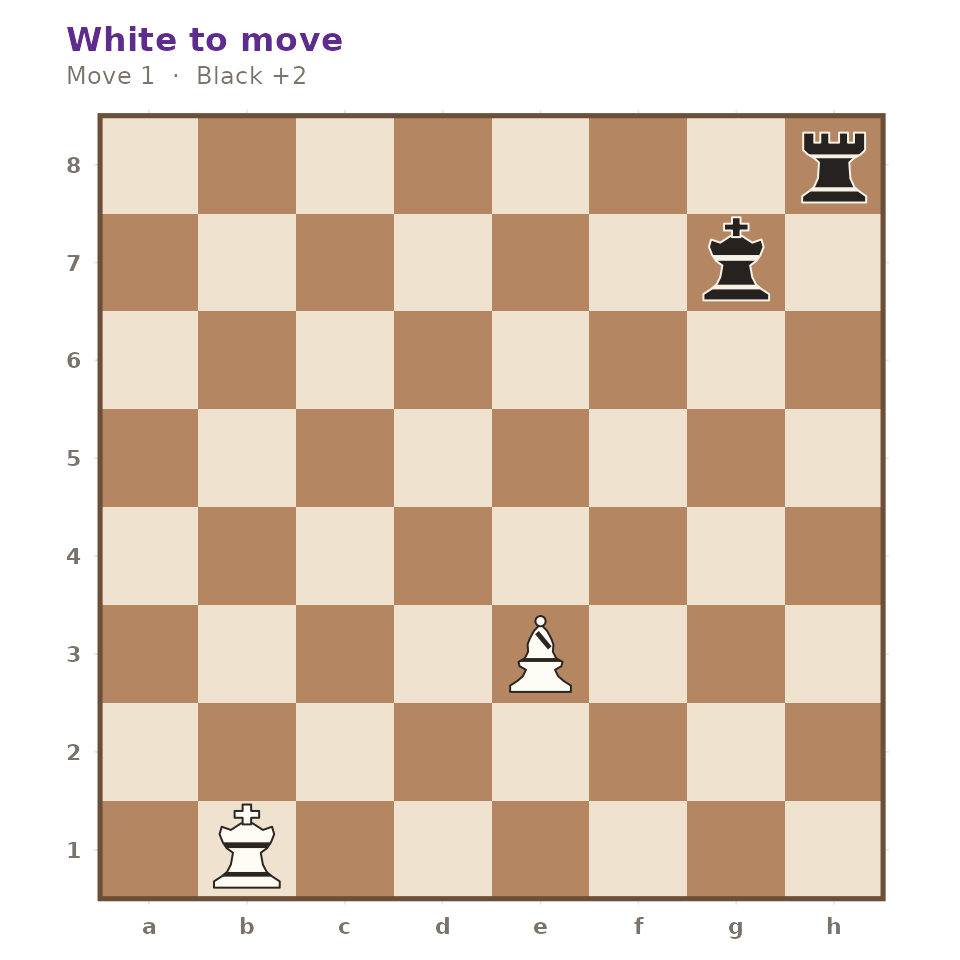
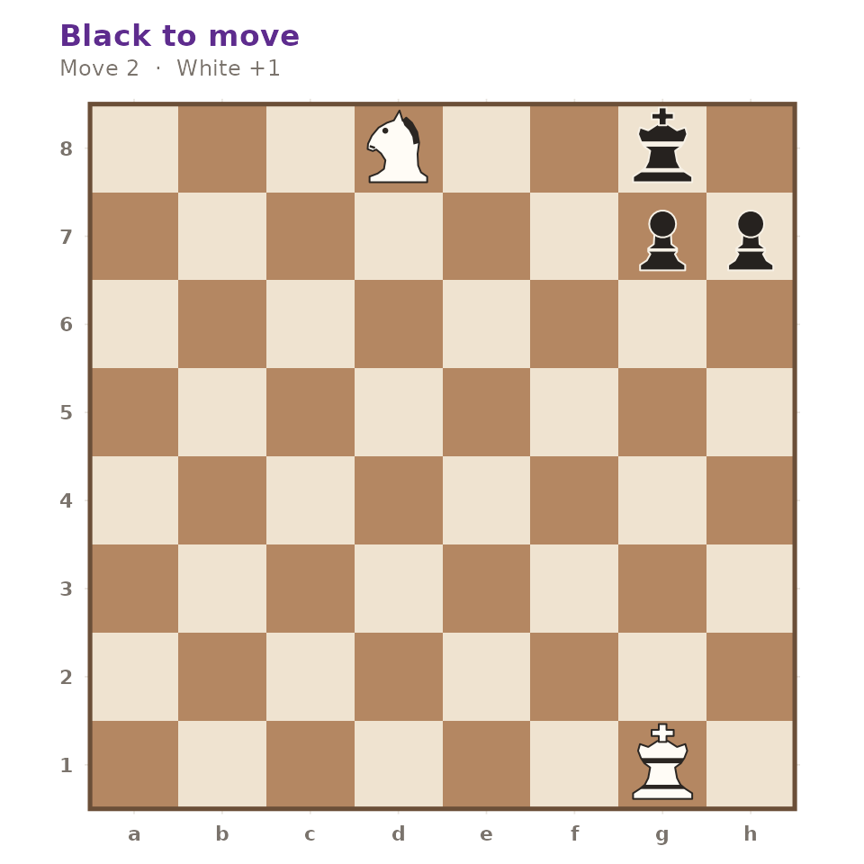

# The Puzzle Trainer

``` r

library(gambitR)
```

The puzzle trainer is a small set of tactical positions with verified
solutions, plus a checker that scores an attempt against them.

## Drawing a puzzle

[`gm_puzzle()`](https://r-heller.github.io/gambitR/reference/gm_puzzle.md)
returns a `gm_puzzle`: the position, the solution as a vector of moves
in standard algebraic notation, a theme and a rating.

``` r

puzzle <- gm_puzzle(seed = 1)
puzzle
#> <gm_puzzle> "gm-0009" — theme "skewer", rating 1100
#> White to move, 1 move to find
#> 8  · · · · · · · ♜
#> 7  · · · · · · ♚ ·
#> 6  · · · · · · · ·
#> 5  · · · · · · · ·
#> 4  · · · · · · · ·
#> 3  · · · · ♗ · · ·
#> 2  · · · · · · · ·
#> 1  · ♔ · · · · · ·
#>    a b c d e f g h
```

``` r

puzzle$theme
#> [1] "skewer"
puzzle$rating
#> [1] 1100
puzzle$solution
#> [1] "Bd4+"
```

The position is an ordinary `gm_position`, so everything else in the
package applies to it.

``` r

gm_plot_board(puzzle$position)
```



``` r

gm_status(puzzle$position)
#> [1] "normal"
```

## Choosing what to practise

A puzzle can be selected by id, filtered by theme, or drawn at random
under a seed for reproducibility.

``` r

gm_puzzle(id = "gm-0005")$solution
#> [1] "Nf7#"
gm_puzzle(theme = "mateIn2", seed = 1)$solution
#> [1] "Qg2"  "Kh7"  "Qg7#"
identical(gm_puzzle(seed = 42)$id, gm_puzzle(seed = 42)$id)
#> [1] TRUE
```

Asking for something that does not exist is an error rather than an
empty draw, and the message lists what is available.

``` r

gm_puzzle(theme = "zugzwang")
#> Error in `gm_puzzle()`:
#> ! No puzzle with theme "zugzwang".
#> ℹ Available themes are "backRank", "fork", "hangingPiece", "mateIn1",
#>   "mateIn2", "pin", "promotion", and "skewer".
```

## Checking an attempt

[`gm_check_solution()`](https://r-heller.github.io/gambitR/reference/gm_check_solution.md)
compares an attempt against the solution as a prefix, so it reports
partial progress rather than a bare pass or fail.

``` r

fork <- gm_puzzle(id = "gm-0008")
fork$solution
#> [1] "Nf7+" "Kg8"  "Nxd8"
```

``` r

gm_check_solution(fork, character())
#> # A tibble: 1 × 3
#>   correct solved_plies total_plies
#>   <lgl>          <int>       <int>
#> 1 FALSE              0           3
gm_check_solution(fork, fork$solution[1])
#> # A tibble: 1 × 3
#>   correct solved_plies total_plies
#>   <lgl>          <int>       <int>
#> 1 FALSE              1           3
gm_check_solution(fork, fork$solution)
#> # A tibble: 1 × 3
#>   correct solved_plies total_plies
#>   <lgl>          <int>       <int>
#> 1 TRUE               3           3
```

A wrong first move scores zero, however plausible it looks.

``` r

gm_check_solution(fork, c("Ne4", "Kg8", "Nxd8"))
#> # A tibble: 1 × 3
#>   correct solved_plies total_plies
#>   <lgl>          <int>       <int>
#> 1 FALSE              0           3
```

Check, mate and annotation marks are ignored, so an attempt written
`Ra8` is accepted for a solution written `Ra8#`.

``` r

back_rank <- gm_puzzle(id = "gm-0001")
gm_check_solution(back_rank, "Ra8")$correct
#> [1] TRUE
gm_check_solution(back_rank, "Ra8#!!")$correct
#> [1] TRUE
```

## Solving one by hand

Because the solution is just a sequence of moves, it replays like any
other line.

``` r

position <- fork$position
for (san in fork$solution) {
  position <- gm_move(position, san)
}
gm_plot_board(position)
```



Black’s reply in that line is forced: after the knight check the king
has exactly one square, which is why the fork wins the rook.

``` r

after_check <- gm_move(fork$position, fork$solution[[1]])
gm_legal_moves(after_check)$san
#> [1] "Kg8"
```

## Where the data comes from

The set lives in `inst/extdata/puzzles.rds` and is generated by
`data-raw/puzzles.R`. That script verifies every puzzle against the move
generator before it is written: the position must be legal, each move of
the solution must be legal in turn, every opponent reply must be the
only legal move available, and any line ending in `#` must really end in
checkmate. The Puzzles tab of
[`gm_run_app()`](https://r-heller.github.io/gambitR/reference/gm_run_app.md)
wraps the same two functions in an interactive board.
